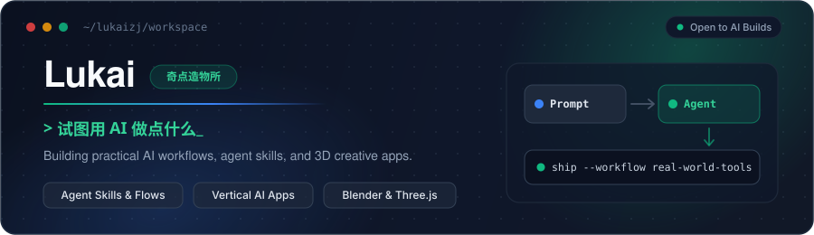

  

### Currently Building

<table>
  <tr>
    <th align="left" width="33%">🤖 Agent Skills &amp; Flows</th>
    <th align="left" width="33%">⚡ Vertical AI Apps</th>
    <th align="left" width="34%">🧊 3D &amp; Creative Tools</th>
  </tr>
  <tr>
    <td valign="top">
      
<b><a href="https://github.com/lukaizj/gzh-article-pipeline">gzh-article-pipeline</a></b> 公众号选题、封面、质检到草稿闭环 Skill

      
<b><a href="https://github.com/lukaizj/mbti">mbti</a></b> 为 AI Agent 注入 16 型工作人格模式

      
<b><a href="https://github.com/lukaizj/moli-wechat-agent">moli-wechat-agent</a></b> 墨流：联网选题与公众号排版 Agent

    </td>
    <td valign="top">
      
<b><a href="https://github.com/lukaizj/SmartBid-Pro">SmartBid-Pro</a></b> 智标通：标书生成与废标项规则桌面台

      
<b><a href="https://github.com/lukaizj/bigdata-sre-platform">bigdata-sre-platform</a></b> 基于 AI 的大数据智能运维助手平台

      
<b><a href="https://github.com/lukaizj/dify-mcp-server">dify-mcp-server</a></b> 支持多 Key 与热加载的 Dify MCP 服务

    </td>
    <td valign="top">
      
<b><a href="https://github.com/lukaizj/car-mod-saas">car-mod-saas</a></b> Next.js + Three.js + Blender 3D 改装台

      
<b><a href="https://github.com/lukaizj/codex-3d-pet">codex-3d-pet</a></b> 本地运行的 VRM 3D 桌面宠物

      
<b><a href="https://github.com/lukaizj/ai-blender-web-showcase">ai-blender-web-showcase</a></b> Blender MCP × Three.js 3D 展台生成器

    </td>
  </tr>
</table>

<table>
  <tr>
    <th align="left" width="52%">🧰 Tech Stack</th>
    <th align="left" width="48%">📡 Follow &amp; Connect</th>
  </tr>
  <tr>
    <td valign="middle">
      

        
        
        
        
        
        
        
      

      Local-first AI tooling · Agent workflows · 3D interactive web
    </td>
    <td align="center" valign="middle">
       
      分享开源实战、Agent 工作流与实用 AI 工具
    </td>
  </tr>
</table>
